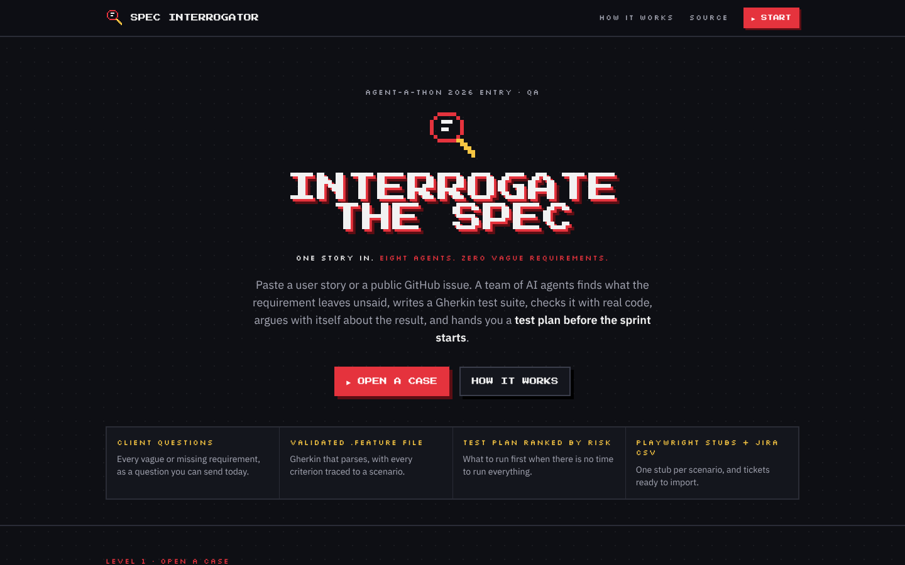
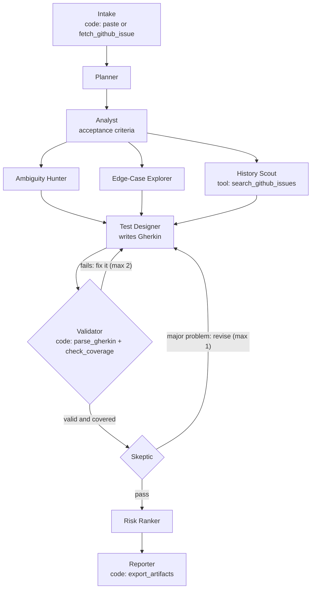
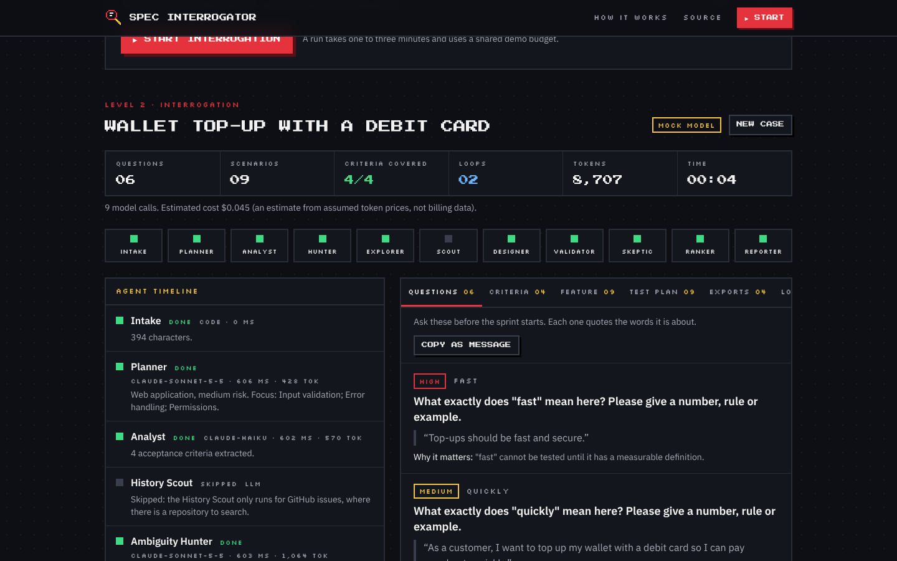

# Spec Interrogator

**Paste a user story or a public GitHub issue. Eight AI agents interrogate it and hand back the questions to ask the client, a validated Gherkin test suite, and a test plan ranked by risk, before the sprint starts.**

Built by Syed Muhammad Ahmad (QA) for the SSI Agent-A-Thon 2026.



## Why

Ambiguous requirements are the cheapest defects to fix and the most expensive to miss. "Top-ups should be fast and secure" costs one message to the client at grooming time, and a change request if it is found in UAT. Spec Interrogator does the first pass a senior QA engineer would do on a new story, in about two minutes, and shows its work.

Who would use it: QA engineers, business analysts and project managers on any delivery project, at sprint grooming.

## What you get

| Output | What it is |
| --- | --- |
| Client questions | Each vague or missing requirement, with the exact words quoted and a question the client can answer in a sentence |
| `.feature` file | Gherkin that parses with the official Cucumber parser, every scenario tagged to the criterion it verifies |
| Test plan | Criteria, edge cases, scenarios in run order by risk, coverage, and known gaps |
| Playwright stubs | One `test.fixme` per scenario with the steps as comments |
| Jira CSV | Clarification tasks and test cases, ready to import |

## How it works





*A finished run. This screenshot was taken with the local stand-in model, which is why it is labelled "Mock model".*

Eight steps call a model. Three are plain code, because parsing and coverage are facts to compute, not opinions to ask a model for.

| # | Step | Kind | Model | Job |
| --- | --- | --- | --- | --- |
| 1 | Intake | code | | Reads the pasted story or fetches the public GitHub issue |
| 2 | Planner | agent | main | Sets domain, risk level and focus areas for the others |
| 3 | Analyst | agent | fast | Extracts testable acceptance criteria, each with a quoted source line |
| 4 | Ambiguity Hunter | agent | main | Finds vague or missing requirements and writes the client questions |
| 5 | Edge-Case Explorer | agent | fast | Boundaries, error paths, permissions, concurrency, state |
| 6 | History Scout | agent + tool | fast | Chooses search terms, searches the repo's closed bugs, extracts lessons (GitHub input only) |
| 7 | Test Designer | agent | main | Writes the Gherkin suite; rewrites it when sent back |
| 8 | Validator | code | | Parses the Gherkin and checks coverage; sends failures back |
| 9 | Skeptic | agent | main | Looks for scenarios that would pass while the feature is broken |
| 10 | Risk Ranker | agent | fast | Sets P1 to P3 per scenario with a reason |
| 11 | Reporter | code | | Builds the four export files |

Steps 4, 5 and 6 run in parallel.

### Where agents check each other

- **Validator to Test Designer.** A draft that does not parse, leaves a criterion or a high-severity edge case uncovered, or has a scenario with no `When` or `Then`, goes back with the exact list of problems. If the file is sound and only coverage is missing, the Test Designer is asked for just the missing scenarios and code appends them, which is quicker and cannot lose existing coverage. At most 2 rounds.
- **Skeptic to Test Designer.** A major objection sends the suite back once. If the revision fails the automated checks, the earlier valid suite is kept: a passing suite is never traded for a failing one.
- **Ambiguity Hunter to Test Designer.** The Test Designer is given the open questions and told to write a `<TBD: ...>` placeholder rather than assume an answer to one. Code, not a model, then tags every scenario that holds a placeholder with `@needs-clarification`, wherever the model wrote the tag.
- **Code checks on what agents cite.** Quotes from the requirement are searched for in the text and flagged if not found. Issue numbers the History Scout cites are dropped unless the search really returned them. Criterion ids are assigned by code, so no agent can reference one that does not exist.

## Guardrails

| Risk | What stops it |
| --- | --- |
| Runaway loops | Hard caps: 2 fix rounds, 1 revision, 2 searches, 1 retry per agent on unusable output |
| Runaway spend | Each run stops at 90,000 tokens or 285 seconds. `max_tokens` is set per agent. Cheap steps use the fast model. Closing the page or pressing Stop cancels the model calls (`supportsCancellation` in `vercel.json`) |
| Abuse of the public URL | Requests must carry the app's own Origin, 32 KB body limit, 8,000 character input limit, 6 runs per IP per 10 minutes, 20 per hour per instance, 4 at once |
| Budget running out while judges are testing | `DEMO_MODE=replay` serves recorded sample runs, clearly labelled as recorded, with no model calls |
| Key exposure | The key is read only on the server from the environment. No `NEXT_PUBLIC_` secrets. `npm run check:secrets` and CI scan every tracked file |
| Prompt injection in pasted text | The requirement is wrapped in tags and every agent is told it is data, not instructions. Closing tags inside the text are defused. No agent has a tool that changes anything |
| Request forgery through the GitHub input | Only `api.github.com` is ever contacted, with owner, repo and number validated by a strict pattern. A user URL is never fetched directly |
| Output injection | Model output is rendered as text only. CSV cells are protected against spreadsheet formula injection. Step text written into the generated Playwright file cannot break out of its comment |

Security headers (CSP, `X-Frame-Options`, `Referrer-Policy`, HSTS and others) are set in `next.config.ts`. The CSP allows `'unsafe-inline'` for scripts and styles because Next.js needs it without per-request nonces; everything else is same-origin only. Fonts are bundled, so the browser makes no third-party requests.

## Honest limits

- **It drafts; a person decides.** Agents can be wrong. The output is a first pass for a QA engineer to review.
- **Rate limits are per server instance.** They live in memory, so on serverless hosting they slow abuse down and do not enforce an exact global cap. The hard spending limit is the LiteLLM key's own budget. `lib/ratelimit.ts` is an interface, so a shared store (Redis, Vercel KV) can replace the in-memory version without touching the route.
- **Throughput.** A run makes 7 to 13 model calls. With the gateway's 60 requests a minute, that is roughly five runs starting per minute.
- **The cost shown on screen is an estimate** from assumed token prices (`PRICE_MAIN`, `PRICE_FAST`), not billing data.
- **Data.** Samples are made up. Paste only public or made-up text. Nothing is stored: there is no database.

## Run it locally

Requires Node.js 20.19 or newer.

```bash
npm install
cp .env.example .env.local     # then fill in the LiteLLM values
npm run dev                    # http://localhost:3000
```

To work on the UI without spending tokens, set `MOCK_LLM=1` in `.env.local`. The mock model returns canned replies and writes a deliberately flawed first draft, so both feedback loops run. The UI labels these runs "Mock model".

| Variable | Required | Purpose |
| --- | --- | --- |
| `LITELLM_BASE_URL` | yes | Gateway address from the organisers, ending in `/v1` |
| `LITELLM_API_KEY` | yes | Personal LiteLLM key. Server only |
| `LITELLM_MODEL` | no | Main model. Default `claude-sonnet-5-5` |
| `LITELLM_MODEL_FAST` | no | Fast model. Default `claude-haiku` |
| `GITHUB_TOKEN` | no | Read-only token for public repos; raises GitHub rate limits |
| `DEMO_MODE` | no | `replay` serves recorded runs only |
| `MOCK_LLM` | no | `1` uses the stand-in model (development only) |

### Checks

```bash
npm run verify    # secret scan, lint, type-check, tests, production build
npm test          # 102 unit and pipeline tests
```

The pipeline tests run the real orchestrator against a scripted model and assert the things that matter: step order, both feedback loops, loop caps when the Test Designer never produces a valid suite, graceful degradation when an agent fails, the token budget, cancellation, and that invented quotes and citations are caught.

### Recording replays

```bash
npm run record                 # one live run per sample, saved to public/replays/
```

This spends real tokens (one run per sample). Commit the JSON files, then set `DEMO_MODE=replay` in Vercel and redeploy if the budget runs low.

## Deploy

Push to `main`; Vercel builds and deploys. Add the environment variables under Project Settings, then redeploy (a changed variable only takes effect on a new deployment).

## Project layout

```
app/
  page.tsx               landing page (static)
  api/run/route.ts       POST: validates, rate-limits, streams the run as NDJSON
  api/status/route.ts    GET: which mode the server is in (no setting values)
components/              Workbench, Timeline, Results, useRun (stream reader + reducer)
lib/
  orchestrator.ts        pipeline order, parallel step, loop caps, degradation
  config.ts              environment and limits, in one place
  agents/                one file per agent: its prompt and its post-checks
  agents/base.ts         the one place a model is called: metering, retry, events
  llm/                   LlmClient interface, LiteLLM client, mock client, usage meter
  tools/                 github, gherkin, coverage, exporters (plain code)
  core/                  types, zod schemas, errors, JSON helpers
  ratelimit.ts           RateLimiter interface + in-memory implementation
  security.ts            origin check, body limit, client key
tests/                   vitest
scripts/                 check-secrets.mjs, record-replays.ts
```

Design notes:

- **One job per module.** An agent file holds a prompt and the code checks on its output. Calling the model, retrying and metering live only in `agents/base.ts`.
- **Depend on interfaces.** The orchestrator receives an `LlmClient`, a `GitHubClient` and its limits as arguments. Tests pass fakes; the route passes the real ones. Nothing in the pipeline imports a vendor SDK.
- **Open for extension.** A new agent is a new file plus one line in `agents/registry.ts`; the UI reads the same registry.

## Hackathon rules

| Rule | How this entry meets it |
| --- | --- |
| Agentic, ideally multi-agent | 8 model agents, 5 code tools, 2 feedback loops, visible step by step in the UI |
| Individual work, own repo, own Vercel account | Yes |
| Public or made-up data only | Samples are invented; the GitHub sample is a public issue |
| Key kept out of the code | Server environment only; scanned in CI |
| Safe agent settings | `.claude/settings.json` sets Accept Edits mode and denies reading `.env` files |
| Live on Vercel | See the repository's About link |

Built with Claude Code, the AI coding tool SSI licenses for this event. Commits made with it carry a `Co-Authored-By` line.

## Roadmap

See [docs/ROADMAP.md](docs/ROADMAP.md) and the repository's milestones.
